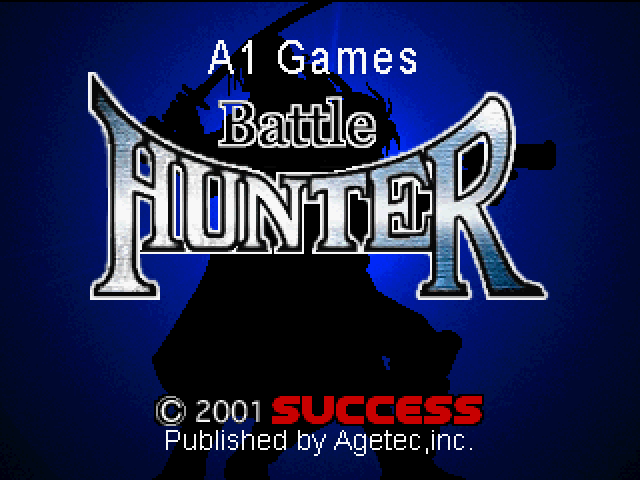
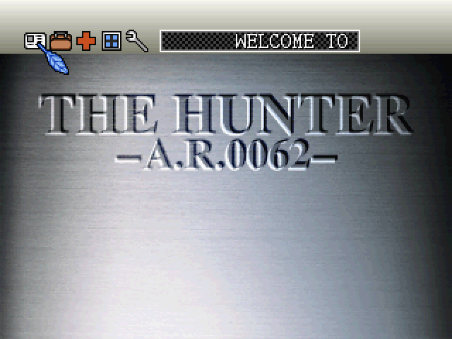
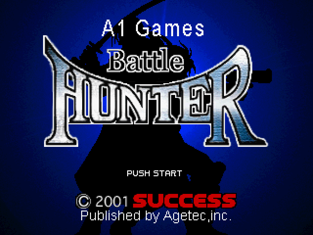
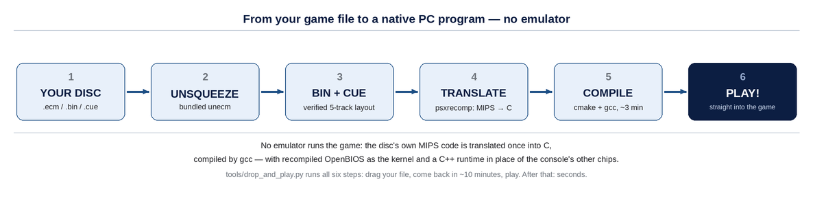

# Battle Hunter, Recompiled

A **static recompilation** port of *Battle Hunter* (PlayStation, USA, serial **SLUS-01335**) to a native PC
program, built on [psxrecomp](https://github.com/mstan/psxrecomp) and
[recomp-ui](https://github.com/RetroPortingToolKit/recomp-ui).

The game's MIPS R3000A machine code is translated **once, ahead of time** into C, which is compiled by an
ordinary PC compiler into a normal executable. No emulator runs the game — the game's own logic executes
directly as x86-64 instructions, on a runtime that re-implements the console's other chips (GPU, SPU, CD
drive, GTE). Even the kernel is real: the free OpenBIOS is recompiled alongside the game.

Verified in play: boot → menus → battles → **game over** → save & load, with the disc's four CD-audio
music tracks playing at the right moments, on a real 8BitDo controller.

| | |
|---|---|
| Players | 2 |
| Region | USA (SLUS-01335) |
| Original | *Battle Hunter*, PlayStation, c. 2000 |

📖 **[docs/Battle-Hunter-Recomp-Explained.pdf](docs/Battle-Hunter-Recomp-Explained.pdf)** — a
plain-English explanation of the whole project (how the disc layout was reconstructed, how the
translation works, how it was tested).

## Quick start

**No checkout, no setup** — download **`BattleHunter-Recomp-Launcher-x86_64.AppImage`** from the
**[Releases](../../releases)** page, then:

```sh
chmod +x BattleHunter-Recomp-Launcher-x86_64.AppImage
./BattleHunter-Recomp-Launcher-x86_64.AppImage   # opens the launcher
```

The whole thing is three clicks:

| | You do | What happens |
|---|---|---|
| **1 · Insert** | pick your `BATTLE HUNTER.iso.ecm` (or just drag it in) | your file never leaves the machine |
| **2 · Recompile** | press the button | the game is rebuilt **from your disc, on your PC** — progress bar + live console, ≈ 2–10 min, once |
| **3 · Play** | press Play (lights up when ready) | boots the recompiled game — later launches are instant |

> **Why can't you just download the game?** This project ships no game content (it's copyrighted) —
> so the launcher *makes* the PC version locally from **your** disc. See
> [What "Recompile" actually does](#what-recompile-actually-does).

Prefer a git clone, a terminal pipeline, or doing each step by hand? All routes:
[Steps (from zero to playing)](#steps-from-zero-to-playing).

## Screenshots

<sub>Captured from the recompiled game running natively on PC (software renderer, native 320×240
VRAM, upscaled 2×). *Battle Hunter* and its artwork remain the property of their original creators.</sub>

<p align="center">
  
</p>
<p align="center"><sub>Title screen · main menu (OST playing) · story dialogue</sub></p>

---

## Distribution model — read this first

**This repository contains no game content.** Nothing derived from the copyrighted disc is committed:

- ❌ not the disc image (`.bin`/`.cue`/`.ecm`)
- ❌ not the translated game C (regenerated **on your machine** from **your** disc — see below)
- ❌ not captured overlay bytes, save data, or Sony's BIOS (the free OpenBIOS is bundled by the framework instead)

What *is* here: the config (`game.toml`), glue code, function *addresses* used as discovery seeds, disc
digests (to verify you have the right revision), the CMake scaffolding, and this documentation. Addresses
and digests are facts about the binary, not expression — this is the same metadata every public recomp
project ships.

The consequence: **you supply the game, you run the generator, you build.** It's a few minutes of fully
automated work — one *Recompile* click in the launcher, whether you run it from the AppImage or a git
checkout — documented below.

## Requirements

- **git**, **Python ≥ 3.11**, **CMake ≥ 3.20**, **Ninja**, and a C/C++ compiler (the recompiler is
  C++20; the runtime is C99/C++17). On Debian/Ubuntu: `sudo apt install git build-essential cmake
  ninja-build python3`. On Arch: `sudo pacman -S git base-devel cmake ninja python`.
- SDL3 — fetched automatically by CMake if no system package is found (network required once).
- For the **GUI launcher** only: GTK3 via PyGObject — on Debian/Ubuntu
  `sudo apt install python3-gi gir1.2-gtk-3.0`, on Arch `sudo pacman -S gtk3 python-gobject`.
  (Everything works from the terminal without it.)
- **Your own copy of Battle Hunter (USA)**. The build checks that your disc matches the supported
  revision (data track SHA-1 `00c0c831…`, 86,003,232 bytes) — if yours differs, the generator will
  tell you instead of guessing.

---

## Steps (from zero to playing)

### The easiest way — the AppImage (no checkout needed)

The AppImage — downloadable from the [Releases](../../releases) page (see
[Quick start](#quick-start) up top) — is the whole project in one file: the repo scaffold (config,
seeds, framework sources, tools) **plus** its own Python + GTK runtime, so it runs with nothing
installed. It carries **no game content** — same distribution model as everything else here.

On first run it deploys the scaffold to a work directory and opens the launcher for the same
three-click flow: **insert your `.ecm`, press Recompile, press Play**. Your disc image, the
generated C, the compiled game and your saves all live in that work directory —
`~/.local/share/BattleHunterRecomp` by default, override with `BH_WORKDIR=…`.

Notes:
- Recompiling needs build tools (cmake/ninja + a C compiler). If the system has none, the launcher
  automatically downloads the framework's bundled toolchain on first recompile (one-time, network).
- Built on Ubuntu 24.04, so it wants a reasonably modern glibc (≥ 2.39): Ubuntu 24.04+, Debian 13+,
  Fedora 40+, Arch/CachyOS, openSUSE Tumbleweed, Mint 22.x. On older distros use the git-checkout
  routes below.
- Updating: download the new AppImage — on next launch the work dir's scaffold refreshes automatically
  (your staged disc, builds and saves are never touched), and the next Recompile picks up the change.
- Maintainers: releases are built by CI — push a tag (`git tag v1.0.0 && git push origin v1.0.0`) and
  the [AppImage release workflow](.github/workflows/appimage-release.yml) builds, smoke-tests, and
  attaches the AppImage to a new GitHub release.

### The easy way — the launcher (recommended for git users)

The launcher is a small GUI: **open it, insert your game file, press Recompile, press Play.** It wraps the
same pipeline the terminal tool uses — unsqueeze, verify, translate to C, compile — with a live **progress
bar** and a scrolling **console output** showing everything that happens. First run ≈ 2–10 minutes
depending on your machine (a from-scratch test on a fast desktop — 86 MB ECM in, everything rebuilt —
took just under 2 minutes); after that, launches are seconds.

```sh
# from zero:
git clone --recurse-submodules <this-repo-url> BattleHunterRecomp
cd BattleHunterRecomp
sh tools/install-drop-and-play.sh   # one-time: registers the launchers with your desktop
```

Then open **“Battle Hunter — Launcher”** from your app grid / desktop icon (or run
`python3 tools/launcher_gui.py`) and:

1. **Insert the game** — click *Browse…* and pick your `BATTLE HUNTER.iso.ecm` (a `.bin`/`.cue` dump works
   too), or simply drag the file onto the launcher window. Dropping the `.ecm` onto the desktop launcher
   icon also works — it opens with the file pre-selected.
2. **Recompile** — one button runs the whole pipeline with a progress bar (per step *and* per compile
   unit) and a console you can scroll through; a revision that isn't the verified USA disc gets a clear
   warning, never a silent guess. Cancel any time. See
   [What "Recompile" actually does](#what-recompile-actually-does) below for a plain-English map of
   the progress bar.
3. **Play** — enabled once a build exists (it also lights up right away if the game is already compiled).
   The game runs independently of the launcher window.

The GUI needs GTK3 via PyGObject (see *Requirements*). No GUI on the machine? Use the terminal tool
below — same pipeline.

### What "Recompile" actually does

One button, four phases — this is exactly what the progress bar walks through:

| Progress bar | Phase | In plain English |
|---|---|---|
| **0–8 %** | Prepare | Your `.ecm` is a *squeezed* disc image (error-correction bytes removed to shrink it). This phase un-squeezes it back to a raw disc image, then fingerprints it to confirm it's the genuine USA *Battle Hunter* disc — a different revision gets a warning, never a silent guess. |
| **8–55 %** | Translate | The PlayStation's machine code is read off **your** disc and rewritten as ordinary C source code, on your machine. This is the *recompilation* itself — nothing is downloaded, and it's why the repo can ship zero game code. |
| **55–95 %** | Compile | A normal PC compiler turns that C into a normal executable — `BattleHunter_Recompiled` — just like compiling any other program. |
| **95–100 %** | Finish | Writes your settings (controller, disc) and a **stamp**. From now on the stamp proves the build matches your disc + this framework, so launches skip straight to *Play* — that's why only the first run takes minutes. |

Things worth knowing:

- **It's fully automatic and one-time.** Watch the console scroll if you're curious; cancel if you
  change your mind. A fresh full run was measured at just under **2 minutes** on a fast desktop,
  ~10 minutes on an older laptop.
- **Your files, your machine.** The disc image is staged to `disc/BattleHunter.bin` + `.cue` (never
  modified), the generated C lands in `generated/`, the game + saves live in `build-release/`.
  Nothing is uploaded anywhere.
- **Forcing a rebuild** — delete `build-release/.bh_stamp` (or just pick a different disc file and
  press Recompile again); picking the same file again is always the fast path.
- **No build tools installed?** With the AppImage, the launcher downloads the framework's bundled
  toolchain (cmake/ninja/clang) on first recompile — one-time, needs network.

<p align="center">

</p>

#### Terminal alternative — Drop & Play

The Drop & Play tool runs the identical pipeline in a terminal. Select your game file by **any** of
these four ways:

| # | How you select the file | What you'll see |
|---|---|---|
| 1 | **Drag & drop** — drag `BATTLE HUNTER.iso.ecm` onto the **“Battle Hunter — Drop & Play”** launcher icon (KDE, or GNOME with desktop icons) | a terminal window opens and streams progress |
| 2 | **Open With** — right-click the `.ecm` → *Open With Other Application* → **Battle Hunter — Drop & Play** (GNOME) | same terminal progress window |
| 3 | **File picker** — launch the tool with no arguments and pick the `.ecm` in the dialog | progress in the launching terminal |
| 4 | **Terminal** — `python3 tools/drop_and_play.py "~/Downloads/BATTLE HUNTER.iso.ecm"` (quote paths with spaces) | progress right in your shell |

Whichever way you select it, the tool then does **all** of the below, by itself:
1. **Unsqueezes** the `.ecm` → `disc/BattleHunter.bin` (builds the bundled `unecm` on first use).
2. **Verifies** you have the supported revision (USA `SLUS-01335`) against known digests — a different
   revision gets a clear warning, never a silent guess.
3. **Reconstructs the cue sheet** (the 5-track layout this project reverse-engineered).
4. **Translates your disc into C** (this is why no game code is in the repo — it's made locally, from your file).
5. **Compiles** the native game with cmake + gcc.
6. **Boots straight into the game** — no launcher click, controller preconfigured.
7. **Stamps** your disc + framework — selecting the same file again is **seconds**, straight to the game
   (delete `build-release/.bh_stamp` to force a rebuild).

First run ≈ 2–10 minutes depending on your machine; after that it's seconds per launch. Add `--no-play`
to stop after the build (e.g. to inspect the result) instead of booting the game.

Where things land and what failure looks like: any error stops the run with the full log visible
instead of a silent error; the staged image, generated C, and builds live in the same places the
[launcher](#what-recompile-actually-does) uses.

<details>
<summary>Self-test (what CI runs after install):</summary>

```sh
# full pipeline + 25s headless boot check, then exits:
python3 tools/drop_and_play.py "/path/to/BATTLE HUNTER.iso.ecm" --soak 25

# GUI launcher smoke test — window builds, renders briefly, exits cleanly:
python3 tools/launcher_gui.py --smoke
```

</details>

### The manual way (same steps, by hand)

If you'd rather run each step yourself:

```sh
# 1. Clone with submodules (the framework + launcher are pinned gitlinks)
git clone --recurse-submodules <this-repo-url> BattleHunterRecomp
cd BattleHunterRecomp

# 2. Provide your disc. Put a BIN/CUE dump at disc/BattleHunter.cue + disc/BattleHunter.bin.
#    From your own original disc, e.g. with any standard dump tool.
mkdir -p disc && cp /path/to/your/dump.cue disc/BattleHunter.cue
cp /path/to/your/dump.bin disc/BattleHunter.bin
```

<details>
<summary>Have a <code>.ecm</code> file instead (like the original this project was built from)? Click for the extra unsqueeze step.</summary>

ECM is a squeeze format that deletes a CD's recomputable error-correction bytes. Unsqueeze it with
Neill Corlett's `unecm` (GPL, 2002):

```sh
# build unecm from the canonical mirror of cmdpack
curl -sfLO https://raw.githubusercontent.com/qeedquan/ecm/master/unecm.c
gcc -O2 -o unecm unecm.c && ./unecm "BATTLE HUNTER.iso.ecm" BattleHunter.bin
```

Then write `disc/BattleHunter.cue` with this track layout (reconstructed for this revision — one data
track, four audio):

```
FILE "BattleHunter.bin" BINARY
  TRACK 01 MODE2/2352
    INDEX 01 00:00:00
  TRACK 02 AUDIO
    INDEX 00 00:55:55
    INDEX 01 00:57:55
  TRACK 03 AUDIO
    INDEX 00 02:29:26
    INDEX 01 02:31:26
  TRACK 04 AUDIO
    INDEX 00 03:59:05
    INDEX 01 04:01:05
  TRACK 05 AUDIO
    INDEX 00 05:28:59
    INDEX 01 05:30:59
```

</details>

```sh
# 3. Translate YOUR disc into C (the repo ships no generated code — this makes it).
#    Builds the recompiler emitters if needed, then emits the game + OpenBIOS C.
python3 psxrecomp/psxrecomp_cli.py generate \
    --config game.toml --project-root . --disc disc/BattleHunter.cue

# 4. Compile the game into a native executable (~2–3 minutes)
cmake -S . -B build-release -G Ninja -DCMAKE_BUILD_TYPE=Release
cmake --build build-release --target psx-runtime -j"$(nproc)"

# 5. Play
./build-release/BattleHunter_Recompiled
```

On first run the launcher asks for the disc image — pick `disc/BattleHunter.cue`. Set your controller
under **Controls** (or see below). That's it: what you're playing is a normal PC program.

### Optional: native overlays (recommended after your first session)

Some scenes stream extra code modules off the disc into memory and run them. Until you compile them,
a tiny built-in interpreter runs those fragments **correctly** (it's the framework's safety net), just
not as translated code. Two commands arm the automatic compiler tier so they become native plug-ins:

```sh
# stage the bundled overlay toolchain next to the game (one-time)
python3 psxrecomp/tools/release_stage.py stage-toolchain \
    --stage build-release \
    --recomp-dir psxrecomp/recompiler/build \
    --recomp-tools psxrecomp/tools \
    --recomp-include psxrecomp/runtime/include \
    --dl-cache ~/.cache/bh-dl --platform linux
```

(The `generate` step in **step 3** builds the emitter binaries under
`psxrecomp/recompiler/build/` — that's the path above.) On the next launch the
runtime logs `overlay autocompile enabled (gcc)` and quietly turns anything
you encounter into native code, keyed by the exact bytes it saw. You can also
pre-compile everything you've already played:

```sh
python3 psxrecomp/overlay_toolchain/compile_overlays.py \
    --captures build-release/overlay_captures.json --game-toml game.toml \
    --recompiler psxrecomp/recompiler/build/psxrecomp-game \
    --runtime-include psxrecomp/runtime/include \
    --out-dir build-release/cache
```

### Controls

Keyboard (defaults): arrows = D-pad · **X = Cross** · S = Circle · Z = Square · A = Triangle ·
**Enter = Start** · Right Shift = Select · Q/E/W/R = L1/L2/R1/R2. Controllers work directly (or via
the launcher's Controls page). In `settings.toml` (written by the launcher), `p1_device = "gamepad"`
means "first connected pad", or pin a specific one by GUID.

### Updating

`git pull --recurse-submodules`, then re-run steps 3–4 (the generator is incremental; unchanged shards
are reused). Easier: just press **Recompile** in the launcher (or re-run Drop & Play) — the stamp
notices that the framework changed and rebuilds only what's needed.

## Troubleshooting

- **The GUI launcher won't start** — it needs GTK3 via PyGObject: Debian/Ubuntu
  `sudo apt install python3-gi gir1.2-gtk-3.0`, Arch `sudo pacman -S gtk3 python-gobject`.
  The terminal Drop & Play tool works without a GUI.
- **"known disc digests do not match"** — your dump is a different revision/region. This project
  targets the USA release (SLUS-01335). Check the data track size: 86,003,232 bytes.
- **No audio** — check your system's pipewire/pulse setup; the runtime outputs via SDL3.
- **Black screen during loads only on an overloaded machine** — the game has disc-load timeouts;
  close heavy background load or don't run unthrottled debug builds during loads.
- **The launcher doesn't list your controller** — it appears as "8BitDo … Wireless" etc. in the
  Controls page after you press a button on it (USB dongles sleep).

## Repository layout

```
game.toml            config the generator/runtime read (disc identity, seeds, quirks)
seeds/               function addresses used as translation discovery hints
codegen_setup.c/.h   title-side codegen hooks
CMakeLists.txt       thin build glue (adds the runtime target)
tools/
  launcher_gui.py     the GUI launcher (insert .ecm → Recompile w/ progress bar +
                      console → Play; GTK3, no build needed)
  bh_pipeline.py      the shared pipeline library both front-ends drive
                      (unsqueeze → verify → generate → compile → launch)
  drop_and_play.py    the terminal front-end over the same pipeline
  make_appimage.sh + appimage_collect.py   build the one-file AppImage
  install-drop-and-play.sh + *.desktop   desktop registration for both
psxrecomp/           submodule → the framework (pinned)
recomp-ui/           submodule → the in-game launcher UI (pinned)
docs/                the plain-English PDF report + img/ (screenshots, pipeline diagram)
generated/          (NOT committed — you create it in step 3)
disc/                (NOT committed — your dump goes here)
```

## Credits & legal

- **psxrecomp** — mstan and the RetroPortingToolkit community (framework + runtime).
- **OpenBIOS** — the PCSX-Redux project (bundled by the framework; MIT).
- **unecm** — Neill Corlett (ECM disc format, GPL).
- *Battle Hunter* is the property of its original developers and publisher. This project is a
  personal-use translation of a personally-owned copy: the repo distributes no game content,
  and you must supply your own disc. No affiliation with or endorsement by the rights holders.